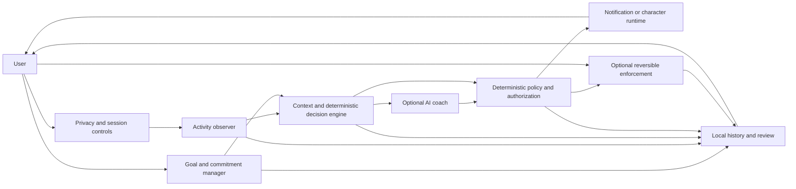

# Wowie

**A customizable, goal-aware AI desktop companion that helps you follow through on your ambitions.**

## What is Wowie?

Wowie is a planned, standalone desktop application for turning personal ambitions into goals and focus commitments, then helping users stay connected to those commitments while they work.

Users tell Wowie what they want to achieve: become a software engineer, learn Rust, finish a personal project, study consistently, or develop a creative skill. Wowie helps shape that ambition into a concrete goal and a manageable next step. When a user starts a focus session and gives permission, Wowie can observe configured desktop activity and compare the available signals with the current goal.

If activity appears to conflict with the user's commitment for long enough to warrant attention, Wowie can offer contextual advice through an ordinary desktop notification or the user's chosen companion character. The user can resume, correct Wowie's assessment, take a planned break, snooze a reminder, or—if configured and explicitly authorized—request a temporary, reversible website block.

Users are not limited to a built-in mascot. Wowie is intended to support user-uploaded, compatible 3D character models, with configurable names, personalities, expressions, animations, voice, and persistent contextual memory as the project develops. Any persistent memory should be optional, visible, editable, and deletable. The goals, activity assessment, and decision policy must work independently of any character format or renderer. A user can use Wowie without a 3D character.

## The problem Wowie addresses

Many productivity tools can record screen time or show statistics without connecting that activity to what a person is trying to do right now. A generic blocker can also miss the difference between a useful tutorial and unrelated entertainment. A basic notification may remind someone to focus, but it does not provide the continuity or personalization of an ongoing companion.

Wowie aims to connect five parts of that experience: the user's own goals, a time-bounded commitment, permitted desktop activity signals, contextual reasoning, and user-controlled accountability. It also aims to help users review progress and recover after a missed commitment instead of treating every lapse as failure.

These are product problems Wowie intends to address. Whether its activity signals and coaching can do so reliably must be established through implementation and testing; this planning document does not claim those problems have already been solved.

## How Wowie is intended to work

1. **Set an ambition and goal.** The user states what they want to achieve and chooses a useful next step.
2. **Make a commitment.** The user chooses when to focus, for how long, and what breaks are allowed.
3. **Choose privacy and activity settings.** Before a session is observed, Wowie explains which desktop signals are available and asks permission. Browser data, AI providers, and other optional capabilities have their own controls.
4. **Focus with context.** During an enabled session, an activity observer supplies only permitted metadata. A context and decision engine considers that evidence alongside the active goal, the user's rules, breaks, idle time, and corrections.
5. **Get support when appropriate.** A rules-based policy decides whether to stay silent, ask for context, or offer a reminder. Optional AI can help explain the situation or phrase a recommendation, but cannot authorize system actions.
6. **Choose what happens next.** The user can resume, correct an assessment, take a planned break, or snooze. If a supported enforcement integration and rule are enabled, Wowie may offer a scoped, temporary website block. The user retains a clear stop and pause path.
7. **Review and recover.** Wowie records relevant session decisions and outcomes for the user to review, subject to retention and deletion controls.

The activity observer cannot reliably understand everything shown on a screen from an application name or window title. A website can contain both learning material and unrelated content. Wowie must preserve uncertainty, invite corrections, and avoid treating entertainment alone as a violation.

## Intended end-to-end example

This describes the product Wowie is intended to become; **none of the behavior below is implemented yet**.

1. A user tells Wowie, “I want to become a software engineer.”
2. Wowie helps the user establish a goal and a 45-minute commitment to work on a coding project.
3. The user starts the focus session and enables the activity monitoring they want to use.
4. Wowie observes permitted desktop activity for the session.
5. The user spends 30 minutes watching unrelated YouTube videos.
6. Wowie recognizes that this activity may conflict with the current commitment and shows the user's chosen character.
7. The character offers contextual advice and lets the user resume work, correct the assessment, or acknowledge a planned break.
8. If the user has enabled a relevant enforcement rule, Wowie can offer to block YouTube for the rest of the session. The target, duration, effect, and stop method are made clear, and the action follows the user's authorization.
9. At the end, Wowie records the session outcome and helps the user review progress.

**Important counterexample:** if the user's active goal is learning Rust and they watch a Rust tutorial, Wowie should not automatically treat that as a distraction. Site identity alone does not establish relevance. The user may provide context or correct a mistaken assessment.

## What makes Wowie different

Wowie's intended product combines:

- **Personal goals and commitments** that give focus sessions a user-defined purpose.
- **Permission-based activity awareness** that is visible, configurable, and easy to pause.
- **Contextual AI coaching** that can explain a possible mismatch and recommend a next step while communicating uncertainty.
- **User-uploaded characters** that can make the companion's presence personal rather than fixed.
- **Configurable interaction** including personality, name, voice, expressions, and animations as supported capabilities are built.
- **Optional, transparent enforcement** that runs through deterministic rules and remains bounded and reversible.
- **Progress history and recovery** that help the user understand a session and make a new plan after setbacks.

A 3D avatar alone is not Wowie. An AI chatbot detached from desktop activity is not Wowie. An activity tracker alone is not Wowie. The intended product brings goals, activity context, coaching, character presentation, and accountable user choices into one coherent desktop experience. This is a statement of design intent, not a claim of absolute market novelty.

## Custom characters and personalization

Wowie is not designed around a predefined anime girlfriend, cat, dog, or other fixed pet. The long-term goal is for users to bring a compatible character model and configure how that character presents support. Users may eventually configure persistent contextual memory so the companion can retain user-approved details about goals and prior conversations; the user must be able to inspect, edit, disable, and delete that memory.

Character import will need compatibility checks, resource limits, safe parsing, and clear reporting of supported rigs, expressions, animations, and declared license information. Formats such as VRM and glTF have different capabilities and are still being evaluated. Wowie must not assume every model is safe or compatible. Missing animations or an unavailable renderer should fall back to a static image or ordinary notification. The accountability engine remains independent of model files and avatar rendering.

See [Avatar system](docs/AVATAR_SYSTEM.md) for the proposed import and compatibility rules.

## Privacy, permissions, and user control

Desktop activity is sensitive. Wowie is intended to collect as little as needed, explain what it observes, keep monitoring visible, and make pausing or disabling it straightforward. Monitoring should be off outside a consented focus session by default. Optional browser information, cloud AI, voice, and future screen-content features require separate explanation and configuration.

Local activity data should not be sent to a cloud model by default. AI should be optional, bounded by resource settings, and unable to execute shell commands or directly control the operating system. AI suggestions go to a deterministic policy layer; any enforcement action must satisfy the user's configured rules and authorization. Users should be able to correct classifications, review relevant history, stop temporary actions, and delete their data.

Linux desktop environments differ in the activity signals and permissions they expose. Wowie must state exactly which environments and integrations have been tested rather than claim universal Linux support. See [Privacy and security](docs/PRIVACY_SECURITY.md), [Activity monitoring](docs/ACTIVITY_MONITORING.md), and [Accountability rules](docs/ACCOUNTABILITY_RULES.md).

## Planned architecture

The following components are **proposed**. They do not describe existing software:

- **Goal and commitment manager** — keeps the ambitions, goals, next actions, and focus sessions the user defines.
- **Activity observer** — collects only permitted desktop metadata through a platform-specific integration and reports when that signal is unavailable.
- **Context and decision engine** — compares activity evidence with the current goal and deterministic user-defined rules, while accounting for breaks, idle time, uncertainty, and corrections.
- **AI coach** — optionally generates contextual explanations, dialogue, and recommendations. It has no authority to bypass policy or execute operating-system commands.
- **Character runtime** — displays the user's chosen character and manages supported expressions and animations. It can be disabled without affecting accountability decisions.
- **Enforcement system** — validates and performs only supported, explicitly authorized actions, with a scope, expiry, stop path, and audit record.
- **History and review** — stores relevant goals, observations, decisions, corrections, and outcomes with privacy, retention, export, and deletion controls.

See [Architecture](docs/ARCHITECTURE.md) for component relationships and data flows, and [Components](docs/COMPONENTS.md) for proposed responsibilities and interfaces.

## MVP scope

The proposed MVP should demonstrate one complete focus-session loop:

- Create a goal and a concrete next action.
- Start, pause, resume, and finish a focus commitment.
- Observe one supported, disclosed desktop metadata signal when the user enables it.
- Detect sustained activity that appears unrelated to the goal while preserving uncertainty.
- Deliver a contextual reminder through a desktop notification.
- Let the user resume, correct the assessment, take a break, or snooze.
- In a later MVP increment, offer an explicitly authorized temporary website block through one selected integration.
- Record the outcome and let the user review the session.

The smallest end-to-end milestone should use notifications and fixture activity data first, then add one named Linux activity integration. That makes the accountability flow testable before the project commits to a particular overlay, renderer, or avatar format. Custom 3D characters remain a central product goal and should follow as a separately gated milestone that proves safe import and rendering of at least one selected format. This boundary stages the work; it does not remove custom characters from Wowie's vision.

The full requirement set and acceptance criteria are in [Product requirements](docs/PRODUCT_REQUIREMENTS.md).

## Current project status

Wowie is in the **planning and documentation phase**. This repository contains planning documents only.

- **Proposed:** the product behavior, architecture, roadmap, and technology recommendations described here.
- **Accepted architectural decisions:** none are recorded as owner-approved yet. The decision register currently contains proposals and deferred decisions.
- **Unresolved:** programming language, desktop UI framework, first supported Linux activity integration, avatar renderer, enforcement mechanism, resource budgets, and several privacy defaults.
- **Implemented and verified:** no application features. Monitoring, AI reasoning, avatar import/rendering, notifications, website blocking, installation, and session tracking are not functional because they have not been built.

The root README defines Wowie's public-facing product identity. Detailed requirements belong in [PRODUCT_REQUIREMENTS.md](docs/PRODUCT_REQUIREMENTS.md); detailed technical decisions belong in the architecture documents. A significant change to the product concept should be reflected here and in the relevant decision record.

## Roadmap

The proposed sequence is:

1. Review the product baseline and accept the necessary architecture, privacy, activity-observation, and policy decisions.
2. Build a small offline vertical slice with goals, session lifecycle, deterministic policy, notifications, and history using fixture activity.
3. Add and verify one named Linux desktop activity integration.
4. Evaluate optional local AI and, separately, explicitly configured cloud AI.
5. Select and validate one reversible website-blocking integration if it remains in scope.
6. Prove safe import and rendering of one user-supplied character format, with notification fallback.
7. Complete packaging, security, privacy, accessibility, performance, and release reviews.

Each phase has entry and exit criteria in the [Roadmap](docs/ROADMAP.md). Work must not begin until the documentation and plan are explicitly approved.

## Documentation index

- [Documentation index and reading order](docs/README.md)
- [Product requirements and acceptance criteria](docs/PRODUCT_REQUIREMENTS.md)
- [User flows](docs/USER_FLOWS.md)
- [Proposed architecture](docs/ARCHITECTURE.md)
- [Component boundaries](docs/COMPONENTS.md) and [internal API contracts](docs/API_CONTRACTS.md)
- [Accountability rules](docs/ACCOUNTABILITY_RULES.md) and [enforcement](docs/ENFORCEMENT.md)
- [Activity monitoring](docs/ACTIVITY_MONITORING.md) and [AI behavior](docs/AI_BEHAVIOR.md)
- [Custom avatar system](docs/AVATAR_SYSTEM.md)
- [Privacy and security threat model](docs/PRIVACY_SECURITY.md)
- [Data model](docs/DATA_MODEL.md), [configuration](docs/CONFIGURATION.md), and [testing strategy](docs/TESTING.md)
- [Technology evaluation](docs/TECH_STACK.md), [decision register](docs/DECISIONS.md), and [architecture decision records](docs/adr/)
- [Implementation roadmap](docs/ROADMAP.md) and [master TODO](docs/TODO.md)
- [Planned operations](docs/OPERATIONS.md)

## Development and contribution status

There is no application code, development environment, dependency manifest, installer, or tested run command yet. The technology choices and coding standards remain subject to review. Installation and usage instructions are therefore not available.

Contributions to planning should follow [CONTRIBUTING.md](CONTRIBUTING.md). The project must remain independent of ForgeX. Do not begin implementation, install dependencies, or scaffold the application until the project owner explicitly approves this documentation and implementation plan. The [TODO](docs/TODO.md) records future work; every task is currently marked **NOT STARTED**.
