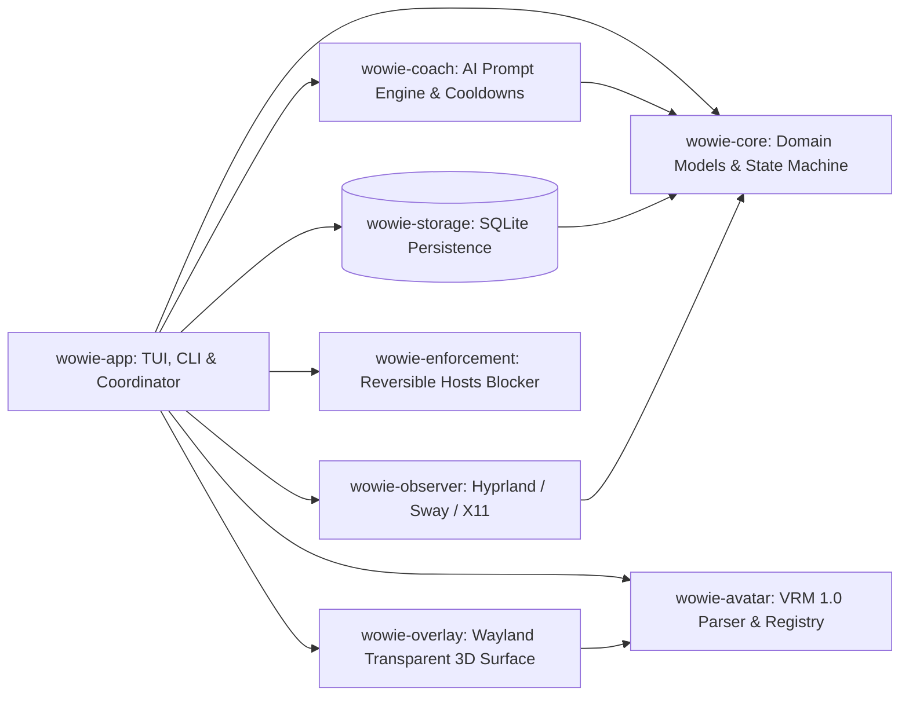

# Wowie

**A customizable, goal-aware AI desktop companion that helps you follow through on your ambitions.**

## What is Wowie?

Wowie is a standalone Linux desktop application for turning personal ambitions into concrete goals and focus commitments, then helping users stay connected to those commitments while they work.

Users tell Wowie what they want to achieve: become a software engineer, learn Rust, finish a personal project, study consistently, or develop a creative skill. Wowie helps shape that ambition into a concrete goal and a manageable next step. When a user starts a focus session and gives permission, Wowie observes configured desktop activity and compares the available signals with the current goal.

If activity appears to conflict with the user's commitment for long enough to warrant attention, Wowie offers contextual advice through an ordinary desktop notification or the user's chosen 3D companion character. The user can resume, correct Wowie's assessment, take a planned break, snooze a reminder, or—if configured and explicitly authorized—request a temporary, reversible website block.

Users are not limited to a built-in mascot. Wowie supports user-uploaded, compatible 3D character models (VRM 1.0 / binary glTF), with configurable names, personalities, expressions, animations, and persistent contextual memory. Persistent memory is optional, visible, editable, and deletable. The goals, activity assessment, and decision policy work independently of any character format or renderer. A user can use Wowie in terminal mode, with ordinary notifications, or with a floating 3D companion overlay.

## The problem Wowie addresses

Many productivity tools can record screen time or show statistics without connecting that activity to what a person is trying to do right now. A generic blocker can also miss the difference between a useful tutorial and unrelated entertainment. A basic notification may remind someone to focus, but it does not provide the continuity or personalization of an ongoing companion.

Wowie connects five parts of that experience: the user's own goals, a time-bounded commitment, permitted desktop activity signals, contextual reasoning, and user-controlled accountability. It also helps users review progress and recover after a missed commitment instead of treating every lapse as failure.

## How Wowie works

1. **Set an ambition and goal.** The user states what they want to achieve and chooses a useful next step.
2. **Make a commitment.** The user chooses when to focus, for how long, and what breaks are allowed.
3. **Choose privacy and activity settings.** Before a session is observed, Wowie explains which desktop signals are available and asks permission. Browser data, AI providers, and other optional capabilities have their own controls.
4. **Focus with context.** During an enabled session, an activity observer supplies only permitted metadata. A context and decision engine considers that evidence alongside the active goal, the user's rules, breaks, idle time, and corrections.
5. **Get support when appropriate.** A rules-based policy decides whether to stay silent, ask for context, or offer a reminder. Optional AI helps explain the situation or phrase a recommendation, but cannot authorize system actions.
6. **Choose what happens next.** The user can resume, correct an assessment, take a planned break, or snooze. If a supported enforcement integration and rule are enabled, Wowie may offer a scoped, temporary website block. The user retains a clear stop and pause path.
7. **Review and recover.** Wowie records relevant session decisions and outcomes for the user to review, subject to retention and deletion controls.

The activity observer does not pretend to understand everything shown on a screen from an application name or window title. A website can contain both learning material and unrelated content. Wowie preserves uncertainty, invites corrections, and avoids treating entertainment alone as a violation.

## Implemented End-to-End Workflow

The full end-to-end focus and coaching workflow is implemented and verified on Linux (Arch Linux with Hyprland and X11):

1. The user launches Wowie on Linux (`cargo run -p wowie-app -- run` or CLI).
2. The user creates a goal, such as "Become a software engineer".
3. The user creates a concrete commitment, such as a 45-minute coding session.
4. The user starts the focus session with monitoring enabled.
5. Wowie observes permitted desktop window metadata (active window title, application class, and browser domain origin).
6. The activity is evaluated against the active commitment using the coaching engine.
7. Sustained likely distraction produces a contextual intervention.
8. The companion character reacts with visual expression changes and desktop notifications.
9. The user can resume work, acknowledge a break, correct the classification, or snooze the intervention.
10. At the end, Wowie records the session outcome, metrics, and user review in local SQLite storage.

You can run an automated live demonstration of this exact 10-step flow on Linux:
```bash
cargo run -p wowie-app -- demo
```

## What makes Wowie different

Wowie combines:

- **Personal goals and commitments** that give focus sessions a user-defined purpose.
- **Permission-based activity awareness** that is visible, configurable, and easy to pause.
- **Contextual AI coaching** that can explain a possible mismatch and recommend a next step while communicating uncertainty.
- **User-uploaded 3D characters** (VRM 1.0 / glTF) rendered via a lightweight, 100% safe Rust Wayland overlay.
- **GPU Hardware Acceleration (Vulkan / WGPU)**: Optional hardware acceleration pipeline alongside the universal pure-Rust software rasterizer (~24% CPU @ 30 FPS without GPU driver dependencies).
- **Expanded Compositor Support**: Native desktop activity awareness across Hyprland, Sway, X11, GNOME Wayland (Mutter D-Bus / XDG Desktop Portal), and KDE Plasma (KWin D-Bus).
- **Speech & Audio Interaction**: Configurable local text-to-speech engine supporting Piper neural TTS, `espeak-ng`, and `spd-say` for voice reminders and celebrations.
- **Configurable interaction** including personality, name, directness, warmth, humor, and reactive mood animations.
- **Optional, transparent enforcement** that runs through deterministic rules and remains bounded, reversible, and backed up.
- **Progress history and recovery** that help the user understand a session and make a new plan after setbacks.

## Custom characters and personalization

Wowie is not designed around a predefined fixed mascot. Users can bring a compatible VRM 1.0 or binary glTF character model.

- **Pre-import security validation:** File size capped at 50MB, binary header checked, external network/file URIs strictly rejected, license/author metadata parsed.
- **Geometry & Material extraction:** Traverses glTF scene graph transforms, extracts vertex positions, normals, colors, materials, and double-sided flags into an internal representation.
- **Desktop Overlay:** Uses a pure-Rust software rasterizer (`softbuffer` + `winit`) with perspective projection, Z-buffering, Lambertian shading, and mood animations (Idle, Focused, Distraction Alert, Snoozed, Celebration), backed by an optional GPU hardware acceleration pipeline (`wowie-overlay::backend`).
- **Voice Synthesis:** Local TTS companion voice via Piper, `espeak-ng`, or `spd-say`.
- **Graceful Fallbacks:** If graphics or Wayland are unavailable, Wowie falls back cleanly to terminal ASCII companion art and native desktop notifications (`notify-send`).

See [Avatar system](docs/AVATAR_SYSTEM.md) for full details.

## Privacy, permissions, and user control

Desktop activity is sensitive. Wowie collects as little as needed, explains what it observes, keeps monitoring visible, and makes pausing or disabling it straightforward. Monitoring is strictly off outside a consented focus session.

- **Local-first:** Local activity data is never sent to a cloud model by default.
- **Zero OS authority for AI:** AI suggestions pass to a deterministic policy layer; AI cannot execute shell commands or control the OS.
- **Hosts enforcement safety:** Demarcated block markers preserve pre-existing entries, atomic writes prevent corruption, and crash recovery restores files cleanly.
- **Prompt injection defense:** Window titles and URLs are quarantined inside `<untrusted_activity_evidence>` XML enclosures with entity escaping and control/BiDi Trojan Source stripping.

See [Privacy and security](docs/PRIVACY_SECURITY.md), [Activity monitoring](docs/ACTIVITY_MONITORING.md), and [Accountability rules](docs/ACCOUNTABILITY_RULES.md).

## Workspace Architecture

Wowie is built as a modular Cargo workspace across 8 specialized crates:



- **`wowie-core`**: Domain entities (`Goal`, `Commitment`, `FocusSession`, `Observation`, `UserCorrection`, `SessionReview`).
- **`wowie-storage`**: SQLite persistence with transaction pool, atomic migrations, active session singleton constraint, and repositories.
- **`wowie-coach`**: AI coaching engine with prompt sanitization, delimiter isolation, deterministic cooldowns, pluggable providers, and offline fallback (548 tests passing).
- **`wowie-observer`**: Linux desktop activity monitoring with native Hyprland (`hyprctl activewindow -j`), Sway (`swaymsg -t get_tree`), and X11 adapters, domain extraction, and consent controls.
- **`wowie-avatar`**: 3D character (VRM/glTF) security bounds validator, metadata extractor, local character registry, binary geometry loader, and companion runtime with mood mapping.
- **`wowie-overlay`**: Lightweight Wayland transparent desktop overlay with pure Rust 3D rasterizer (Z-buffer, directional lighting, perspective camera, mood animation transforms, and HUD pill).
- **`wowie-enforcement`**: Scoped, reversible website distraction enforcement with essential developer tool immunities, section-demarcated hosts handling, crash recovery, and single-use confirmation tokens.
- **`wowie-app`**: Application coordinator, interactive 8-screen terminal UI, overlay bridge, and CLI subcommands.

## Installation & Packaging

### Arch Linux (`makepkg` / AUR)

Wowie provides an official, audited `PKGBUILD` and desktop integration in `packaging/arch/`:

```bash
# Build the Arch Linux package from source
cd packaging/arch
makepkg -efd

# Install the generated package
sudo pacman -U wowie-0.1.0-1-x86_64.pkg.tar.zst
```

The package installs:
- Executables: `/usr/bin/wowie`, `/usr/bin/wowie-overlay`, `/usr/bin/wowie-browser-host`
- Desktop Launcher: `/usr/share/applications/wowie.desktop`
- Icons: `/usr/share/icons/hicolor/scalable/apps/wowie.svg`
- Browser Native Messaging Manifests: `/etc/chromium/native-messaging-hosts/`, `/etc/opt/chrome/native-messaging-hosts/`, `/usr/lib/mozilla/native-messaging-hosts/`

User data in `~/.local/share/wowie` and `~/.config/wowie` is never touched by package upgrades or uninstallation.

### Browser Extension (WebExtensions Native Messaging)

To report active browser origins with strict path and query parameter stripping:

1. Register the native messaging host (no root required):
   ```bash
   ./scripts/install-browser-host.sh
   ```
2. In your browser (Brave, Chrome, Chromium, or Firefox), load the unpacked extension from `extensions/browser/`.
3. Open the extension popup to verify the connection status and review privacy disclosures.

## Quickstart & Running

### Prerequisites
- Rust 1.80+ (`cargo`)
- Linux desktop environment: Hyprland (Wayland) recommended; Sway and X11 supported

### Build & Test
```bash
# Verify formatting
cargo fmt --check

# Check compilation across all targets
cargo check --workspace --all-targets

# Run strict Clippy linter (zero warnings)
cargo clippy --workspace --all-targets -- -D warnings

# Run all workspace unit, integration, and adversarial tests (767 tests pass offline)
cargo test --workspace
```

### Running the Application

```bash
# 1. Interactive Desktop Companion TUI (8 navigation screens)
cargo run -p wowie-app -- run

# 2. Launch the 3D Desktop Companion Overlay (Wayland / Hyprland)
cargo run -p wowie-app -- overlay
# Or run standalone overlay binary
cargo run -p wowie-overlay

# 3. Automated 10-Step End-to-End Demonstration Workflow
cargo run -p wowie-app -- demo

# 4. CLI Subcommands
# Manage Goals
cargo run -p wowie-app -- goal list
cargo run -p wowie-app -- goal create "Master Rust and Linux" "Complete Wowie system"

# Manage Focus Sessions
cargo run -p wowie-app -- session start
cargo run -p wowie-app -- session status
cargo run -p wowie-app -- session pause
cargo run -p wowie-app -- session resume
cargo run -p wowie-app -- session break
cargo run -p wowie-app -- session complete "Completed focus sprint"

# Perform a single observation and coaching evaluation tick
cargo run -p wowie-app -- tick

# 5. Manage 3D Companion Characters
cargo run -p wowie-app -- character list
cargo run -p wowie-app -- character select <id>
cargo run -p wowie-app -- character 3d-info
cargo run -p wowie-app -- character import /path/to/character.vrm
```

## Documentation Index

Comprehensive documentation is available in the [`docs/`](docs/) directory:

- [User Manual](docs/USER_MANUAL.md) — Comprehensive guide to focus workflows, TUI navigation, 3D overlay, browser extension, and CLI.
- [Operations & Release Guide](docs/OPERATIONS.md) — Packaging, clean setup walkthrough, support matrix, and performance metrics.
- [Troubleshooting & Diagnostics](docs/TROUBLESHOOTING.md) — Edge case recovery, display configuration, and /etc/hosts restoration.
- [Changelog](docs/CHANGELOG.md) — Release notes and milestone completion history.
- [Third-Party Notices](THIRD_PARTY_NOTICES.md) — License inventory and attribution for all 290 dependencies.
- [Product Requirements](docs/PRODUCT_REQUIREMENTS.md) — Requirement specifications and acceptance criteria.
- [Architecture](docs/ARCHITECTURE.md) — System boundaries, data flows, and module contracts.
- [Components](docs/COMPONENTS.md) — Responsibilities and interfaces for each workspace crate.
- [Activity Monitoring](docs/ACTIVITY_MONITORING.md) — Linux desktop adapters and domain extraction analysis.
- [AI Behavior](docs/AI_BEHAVIOR.md) — Advisory rules, prompt isolation, and zero-authority boundaries.
- [Accountability Rules](docs/ACCOUNTABILITY_RULES.md) — Cooldowns, thresholds, and intervention policies.
- [Avatar System](docs/AVATAR_SYSTEM.md) — VRM 1.0 validation, 3D rasterization pipeline, and companion mood mapping.
- [Enforcement](docs/ENFORCEMENT.md) — Safe, reversible hosts file distraction blocking and crash recovery.
- [Architecture Decision Records (ADRs)](docs/adr/) — Accepted architectural choices (ADR-001 through ADR-005).
- [Master Implementation Checklist](docs/TODO.md) — Detailed milestone tracking and verification evidence.
