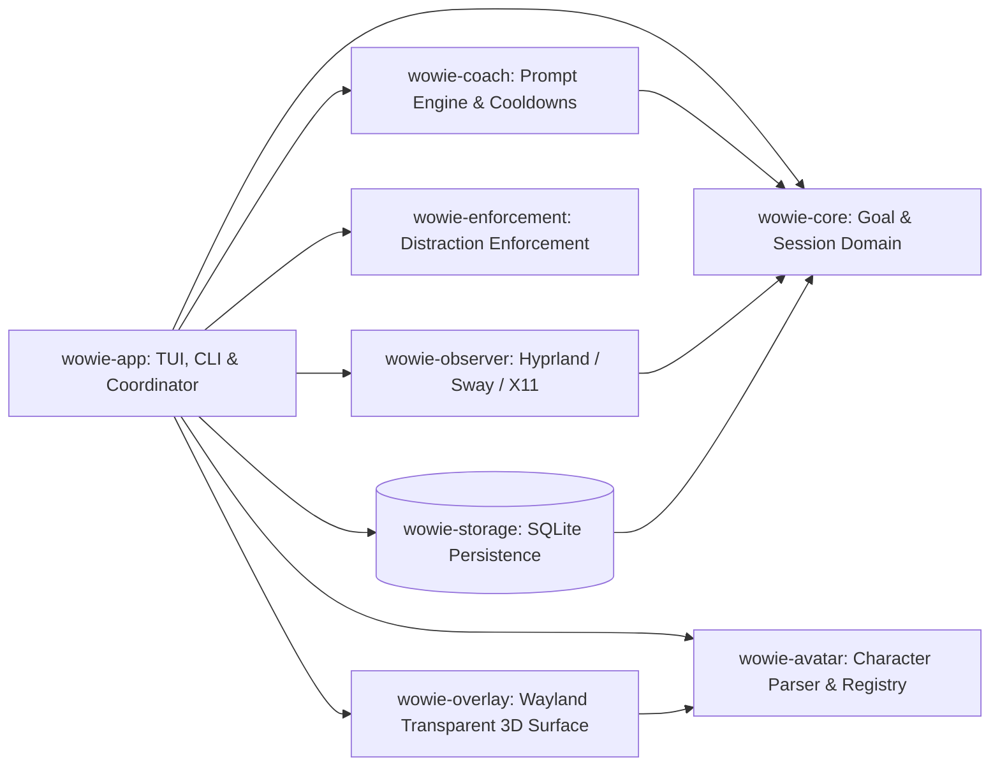

# System Architecture

**Status:** Implemented & Verified across all 8 workspace crates on Linux (Arch Linux with Hyprland / Sway / X11). Global behavioral invariants are governed by [Accountability rules](ACCOUNTABILITY_RULES.md).

## Principles and Shape

- **Modular Cargo Workspace:** Divided into 8 focused crates with strict compile-time dependency boundaries and `#![forbid(unsafe_code)]`.
- **Inward Dependency Direction:** Core domain models (`wowie-core`) and storage (`wowie-storage`) have zero dependencies on GUI frameworks, AI SDKs, or window managers.
- **AI as Advisory-Only:** The AI coach (`wowie-coach`) provides structured recommendations. A deterministic policy layer validates every intervention, cooldown, and candidate action.
- **Process and Graphics Isolation:** The 3D character overlay (`wowie-overlay`) runs independently and communicates with the application coordinator via an asynchronous event bridge. Graphics or compositor failures degrade cleanly to terminal ASCII art and desktop notifications without disrupting focus sessions.
- **Local-First & Offline:** All core focus tracking, activity evaluation, and SQLite persistence operate 100% offline without requiring external network connectivity or cloud accounts.

## Principal Components

## Workspace Crate Responsibilities

| Crate | Responsibilities | Key Dependencies | Isolation & Safety |
| :--- | :--- | :--- | :--- |
| **`wowie-core`** | Domain models (`Goal`, `Commitment`, `FocusSession`, `Observation`, `UserCorrection`, `SessionReview`), strongly-typed IDs, session state machine. | None (pure domain logic) | Zero I/O, `#![forbid(unsafe_code)]` |
| **`wowie-storage`** | SQLite persistence, atomic schema migrations, connection pooling, active session singleton constraint. | `rusqlite`, `wowie-core` | ACID transactions, zero network calls |
| **`wowie-coach`** | AI prompt synthesis, delimiter isolation (`<untrusted_activity_evidence>`), deterministic cooldown tracker, provider traits, and safe advisory fallbacks. | `wowie-core`, `serde`, `tokio` | Zero OS execution authority, 548 offline tests |
| **`wowie-observer`** | Linux desktop activity sampling (native Hyprland socket, Sway IPC tree, X11 xdotool), title redaction, browser domain extractor. | `wowie-core` | Read-only window metadata, sampling consent gates |
| **`wowie-avatar`** | Untrusted VRM 1.0 & glTF security bounds validator (50MB cap, magic byte check, URI rejection), scene graph transformer, character registry. | `gltf`, `serde_json`, `wowie-core` | Zero script execution, safe memory allocation |
| **`wowie-overlay`** | Lightweight Wayland transparent overlay window, pure-Rust 3D software rasterizer (Z-buffer, directional lighting, mood animations), HUD pill. | `winit`, `softbuffer`, `wowie-avatar` | 100% safe Rust, low CPU (~24% @ 30 FPS, <35MB RSS) |
| **`wowie-enforcement`**| User-authorized distraction enforcement, section-demarcated hosts handling, crash recovery, essential tool immunities. | `wowie-core` | Single-use confirmation tokens, pre-existing entry preservation |
| **`wowie-app`** | Desktop coordinator, interactive 8-screen terminal UI, overlay bridge, CLI subcommands (`run`, `demo`, `goal`, `session`, `tick`). | All workspace crates | Coordinates focus loop, recovers state on restart |

## Data Flow: Observation to Coaching Decision

1. The user starts a focus session and explicitly enables desktop activity monitoring.
2. `wowie-observer` samples the active foreground window (e.g. via `hyprctl activewindow -j`).
3. Window titles, application IDs, and browser domain origins are packaged into an `UntrustedObservation`.
4. `wowie-coach` encapsulates the observation within `<untrusted_activity_evidence>` XML tags, stripping BiDi Trojan Source characters, terminal control codes, and escaping XML entities.
5. The `CoachEngine` checks pacing and cooldown status:
   - If an intervention cooldown, planned break, or active snooze is in effect, evaluation is throttled early to save compute/tokens.
   - Otherwise, the structured prompt is evaluated against the active commitment using the configured provider (or offline heuristic).
6. Output is parsed against a strict schema; unrecognized fields or out-of-allowlist actions are discarded.
7. If an off-task mismatch is detected, a contextual intervention is emitted.

## Data Flow: Decision to Character Reaction

1. The coordinator emits a `CompanionEvent` (e.g. `FocusStarted`, `DistractionDetected`, `SnoozeStarted`, `GoalCompleted`).
2. The companion state transitions to the corresponding mood (`Idle`, `Focused`, `DistractionAlert`, `Snoozed`, `Celebration`).
3. The event is simultaneously dispatched to:
   - **3D Overlay Window:** Updates real-time mesh rotation, hover bob cadence, eye tilt, and HUD status pill.
   - **Terminal UI / ASCII Fallback:** Updates the ASCII companion art and dialogue bubble.
   - **Desktop Notifications:** Fires a native desktop notification (`notify-send`).
4. If the overlay window or display server is unavailable, the fallback pathways continue operating seamlessly.

## Control Flow: Authorized Enforcement

1. When sustained distraction is detected and the user has configured an enforcement rule, the AI may suggest a candidate action (`ActionCandidate::Remind` or proposed block).
2. The deterministic enforcement policy validates the candidate against essential developer immunities (`crates.io`, `github.com`, `docs.rs`, `rustc`, `cargo` can never be blocked).
3. The UI presents an explicit confirmation prompt displaying the target, duration, and stop mechanism.
4. If confirmed, a single-use token is generated.
5. `LinuxEnforcementAdapter` writes the temporary block within strict demarcation markers in the hosts file, backing up the original file first.
6. The block is automatically removed upon session completion, user cancellation, expiration, or application crash recovery.
