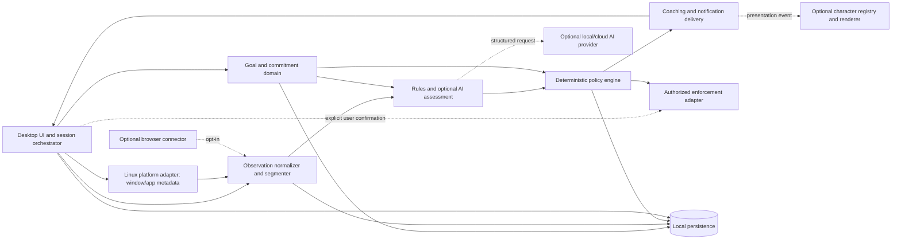

# Proposed architecture

**Status:** proposal; no components described below exist yet. This document describes a modular single-user desktop application, not deployed services. Global behavioral invariants are in [Accountability rules](ACCOUNTABILITY_RULES.md).

## Principles and shape

- One local application/process for the MVP, with modules and narrow contracts. Split processes only if a concrete platform, crash-isolation, or privilege boundary requires it.
- User interface and OS adapters are outer layers. Domain goals, session state, assessment, deterministic policy, and storage contracts remain testable without a desktop session.
- AI can provide structured advice only. A deterministic policy engine validates every intervention and action.
- Character UI is a replaceable presentation adapter. Goals, sessions, and accountability decisions do not depend on it.
- Platform APIs and external providers are behind interfaces; unavailable adapters degrade safely.
- Local storage is authoritative. No cloud service is required for core operation.

## Principal components

## Responsibilities and dependency direction

The UI orchestrates user-confirmed transitions and communicates status. Platform adapters expose only consented signals. Normalization turns raw transient events into bounded, typed segments and drops unnecessary fields. Goal/domain logic owns user-authored goals and sessions. Assessment may combine user rules with optional AI and returns evidence, confidence, and explanation. Policy owns thresholds, cooldowns, consent gates, allowed actions, expiry, and rate limits. Coaching formats a policy-approved prompt and emits a presentation-neutral event. Character and notification adapters render that event. Enforcement adapters implement only explicit, validated requests. Persistence owns transactions, migrations, retention, export, and deletion. Dependencies point inward to domain contracts; domain code must not import window managers, AI SDKs, renderer APIs, or blocking mechanisms.

## Data flow: observation to coaching decision

1. User starts a session and separately enables a declared monitoring scope.
2. Platform adapter emits app/window metadata (and optional browser metadata only after separate configuration).
3. Normalizer timestamps, deduplicates, bounds, redacts, and groups events; idle and known break states are represented explicitly.
4. Assessment receives current goal/commitment and relevant segments, not unrestricted desktop access. It may use deterministic allow/block/context rules and optionally ask an AI provider for a schema-bound assessment.
5. Policy checks session state, consent, evidence duration/confidence, break rules, correction/snooze state, cooldowns, and configured safety constraints.
6. If permitted, policy emits a coaching decision with basis and allowed choices; otherwise it records a no-op or asks for context only where appropriate.

## Data flow: decision to character reaction

The policy emits a presentation-neutral event (e.g. possible mismatch, session progress, goal completed). Coaching may produce text from a template or optional AI response. The presentation dispatcher sends the same safe event to a desktop notification and/or enabled renderer. Character state may select an idle/expression/gesture mapping, but it cannot modify the decision, policy, monitoring, or action list. If the renderer crashes, the dispatcher falls back to a notification and records a diagnostic without activity payloads.

## Control flow: authorized enforcement

The AI and classifier may at most suggest a typed action candidate. Policy verifies a live session, user-configured rule, supported adapter, scope and maximum duration. UI presents exact target, effect, expiry, and stop method. Only an explicit user confirmation creates an authorization token bound to that target and expiry. The adapter revalidates the token and platform state, applies the reversible action, emits audit events, and removes it on expiry/stop/shutdown where supported. No AI code can call the OS directly. See [Enforcement](ENFORCEMENT.md).

## Boundaries, storage, and platform abstraction

One local database stores goals, sessions, minimal event summaries, classifications with provenance, decisions, corrections, settings, and asset references. Large avatar files live in a separate app-managed data directory; database records contain paths/IDs and validation metadata, not embedded binaries. Raw window titles/URLs should be transient unless a reviewed retention rule justifies keeping them. A platform interface reports capability and status rather than pretending features are uniform. Browser integration and screen capture are separate opt-in adapters.

## Errors, background work, and resources

All adapters have explicit unavailable, denied, timed-out, and failed states. Monitoring stops on user pause or consent revocation. AI calls are bounded by timeout, cancellation, and a configured budget; missed response means baseline policy only. Sampling and segmentation use one scheduled task where possible rather than per-window polling loops. Renderer frame rate and visibility are bounded; hiding/disabling it releases rendering work. Database writes are batched only within a short durability window; session transitions and user actions are committed promptly. Shutdown cancels tasks, stops monitoring, attempts to remove temporary enforcement, flushes necessary records, and reports unresolved cleanup.

## Testability and extensibility

Use fake clocks, fixture observation sources, deterministic AI fixtures, in-memory persistence, notification fakes, enforcement fakes, and renderer event fakes. Platform and provider adapters have contract tests. New character formats implement import/validation and presentation capabilities without changing policy. New enforcement types must be added to a fixed allowlist and receive a safety review.

## Constraints and trade-offs

Wayland intentionally limits ambient cross-client observation; APIs differ by desktop/compositor. A native shell integration may be required for reliable active-window state. Webview GUI shells may simplify UI but do not automatically solve global overlays or native metadata. Browser URL access costs a separate extension and privacy boundary. VRM may standardize humanoid features but does not ensure every asset is renderable, licensed, lightweight, or compatible with a chosen runtime. These are open feasibility questions, not hidden implementation assumptions.

