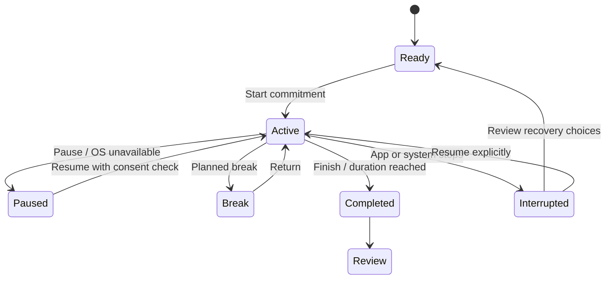
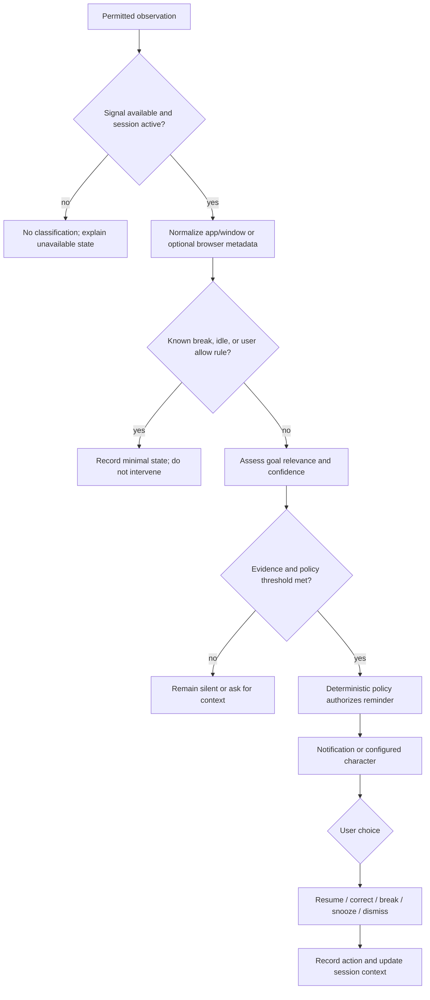

# User flows

Flows describe proposed behavior; they are not implemented.

## First launch and onboarding

Explain that Wowie is a goal-support tool, not surveillance software. Offer a no-monitoring mode first; collect an ambition and optional goal; explain the selected desktop signal before requesting permission; explain AI mode separately; let the user skip AI, voice, and character. Show what will be stored, how to pause, and how to delete data. Do not require importing a model.

## Create goal and commitment

User enters ambition → chooses a nearer-term goal → writes one concrete next action → chooses session duration and break allowance → reviews monitoring scope and AI setting → saves. Wowie may suggest smaller wording but user owns and confirms it.

## Focus session lifecycle

Starting a session records a timestamp and consent snapshot. Pausing stops observation and intervention timers; it does not create hidden background monitoring. On restart, the user chooses to resume, end, or discard an interrupted session.

## Potential distraction and correction

The user can mark an app/site as relevant, unrelated, or context-dependent. Corrections apply according to a visible scope (current event, session, or persistent rule); no silent global rule is inferred.

## Intervention actions

- **Resume:** dismiss prompt and continue session.
- **Correct:** record that evidence was misread and optionally select relevance; policy suppresses repeat prompts for the configured cooldown.
- **Planned break:** suspend mismatch timing for the configured break allowance.
- **Snooze:** suppress prompt for a chosen bounded interval; does not alter commitment or silently start a block.
- **Temporary block:** show exact targets, duration, adapter, and stop method; require an explicit second confirmation; see [Enforcement](ENFORCEMENT.md).

## Character import and configuration

Choose file → validate size/container and parse in constrained importer → show preview and validation report → present declared license/usage metadata and missing permissions → user accepts terms and confirms local storage → choose name/personality/presentation → set as active or fall back. Invalid or unsupported assets do not prevent using notifications. Deletion removes managed asset files and profile links.

## AI and privacy settings

Choose no AI, local provider, or optional cloud provider → show data fields sent and purpose → test connection without sharing activity history → explicitly enable session use. Provide a persistent mode indicator and one-click disable. Cloud mode must not be enabled by onboarding defaults.

## Missed commitment and recovery

At missed/abandoned session review, show facts without moral judgment, ask whether the goal or schedule changed, let the user revise the next action or plan a new commitment, and optionally record a recovery note. No penalty is applied solely because a commitment was missed.

## Disable or pause

From session UI and main settings, user can pause observation, end session, stop an active temporary block, disable AI, or disable the companion. These controls stay accessible if notification, AI, renderer, or platform adapter fails.

